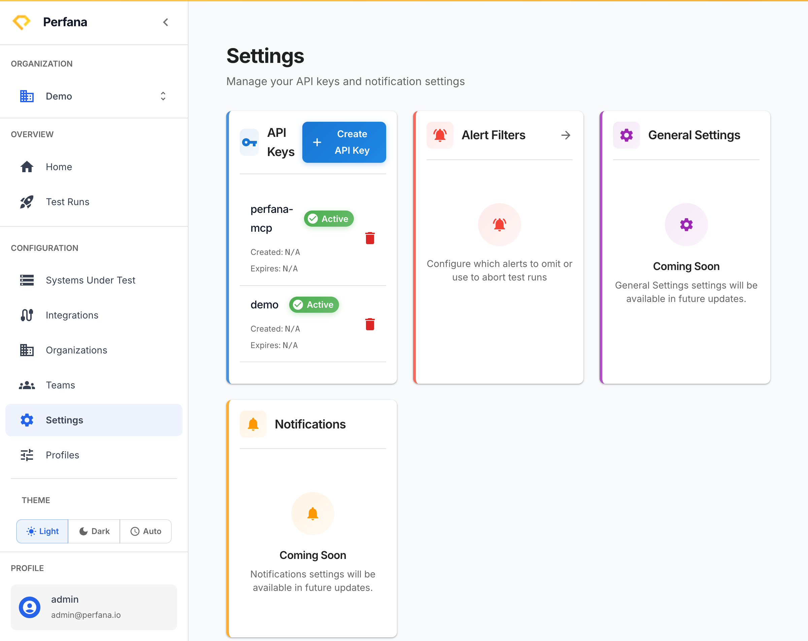

# Create an API key

Create an API key so your CI pipeline or load-test tool can authenticate to Perfana and send test runs. The key is used as a Bearer token in the requests that ingest results.

**Before you start**
- Select your active organization in the sidebar (**Configuration** group).
- Decide which organization the key should be scoped to.

**Steps**
1. In the sidebar, open **Settings**.
   The Settings hub opens with the subtitle "Manage your API keys and notification settings".
2. On the **API Keys** card, click **Create API Key**.
   A dialog opens for the new key.
   
   *Figure: the Settings page - the API Keys card.*
3. Give the key a description and **scope it to an organization**.
   The key will only authenticate for resources in that organization.
4. If the key is for an AI agent that should leave its findings on test runs through the Perfana MCP server, tick **Allow writing comments (for an AI agent)**.
   This adds the `comments:write` role. Leave it unticked for CI and load-test keys: without it a key can read comments but not write them.
5. Create the key, then **copy the token**.
   The full token is shown only once — copy and store it securely now.
6. Use the token as a Bearer token in your CI/load-test tool when sending runs.
   Requests authenticated with the key can ingest test runs into the scoped organization.

**Result**
You have an API key that CI and load-test tools can use to send runs to Perfana. To revoke it, return to the **API Keys** card and click **Delete**.

## A key for an AI agent

A key with **Allow writing comments** can post comments on the test runs of its organization, reply to comments and edit or retag the comments it wrote itself. That is all the option adds:

- It cannot delete any comment, moderate, or mark comments as read.
- Its comments are signed with the key's description, so give it a description people will recognise, for example *Claude analysis agent*.
- Its comments show an **AI** chip next to that name and are never posted to Slack, Teams or Mattermost channels.
- It can write at most 100 comments and 200 replies on one test run.

Any user who may create a key can tick the option; it does not need a role you hold yourself. To configure the agent, set the token as `PERFANA_API_KEY` for the Perfana MCP server; see the server's README for the comment tools and an example.

**Troubleshooting**
- *You lost the token* — Tokens are shown only once and cannot be recovered. Delete the old key and create a new one.
- *The agent says the key cannot write comments (403)* — The key was created without **Allow writing comments**. The option cannot be added later; create a new key with it ticked.
- *401 Unauthorized when sending runs* — Confirm the token is sent as a Bearer token and that the key has not been deleted or expired.

**Related**
- [Send your first test run](../test-runs/send-first-run.md)
- [Comment on a test run](../test-runs/comments.md) — including comments written by AI agents
- [Manage organizations](organizations.md)
