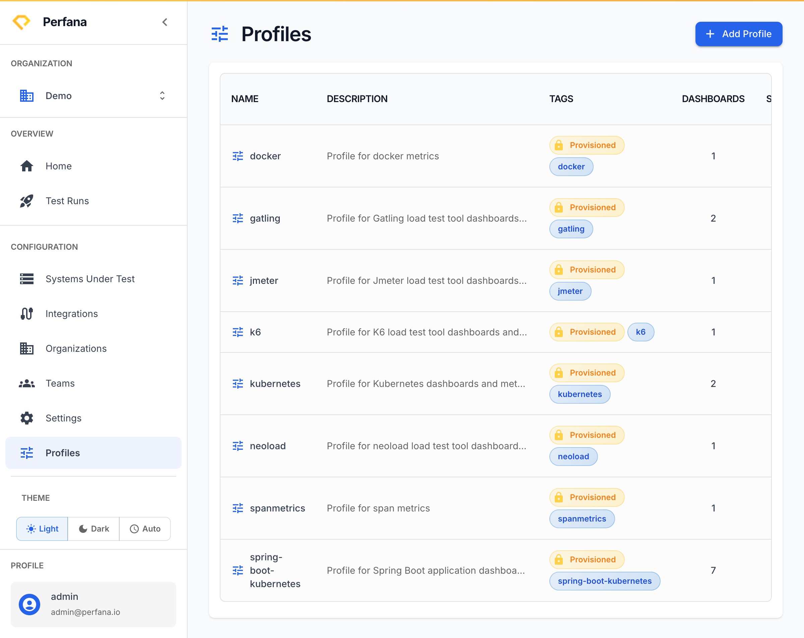
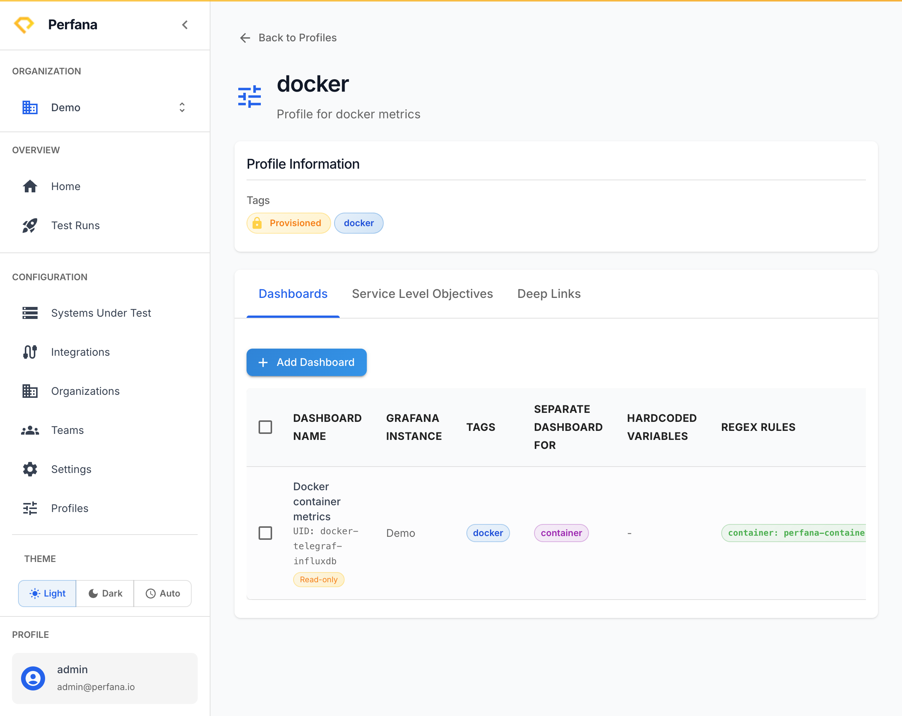

# Create a profile

A profile is a reusable bundle of dashboards and SLOs. Create one so new test runs inherit a standard set of dashboards and checks automatically, instead of you configuring each system from scratch.

**Before you start**
- Select your active organization in the sidebar.
- Know which dashboards and SLOs you want every run to inherit.

**Steps**
1. Go to **Profiles** (`/settings/profiles`).
   You see a table of existing profiles.
   
   *Figure: the Profiles list.*

2. Click **Add Profile**, then enter a **name**, a **description** and any **tags** the profile should match.
   A test run inherits a profile when the two share at least one tag, in the same organization. Tags are matched exactly, so `WERKNL` and `werknl` are two different tags. The field suggests tags your other profiles already use; press Enter to add one.
   The profile appears in the table.

3. Open the new profile to see its detail page (`/settings/profiles/[id]`).
   You see the profile's tabs: **Dashboards**, **Service Level Objectives**, and **Deep Links** (coming soon).
   
   *Figure: a profile's detail tabs.*

4. On the **Dashboards** tab, click **Add Dashboard** and add each dashboard you want runs to inherit.
   The dashboards appear in the list.
   To group a dashboard's per-pod series (for example, `api-7d4f9c-x2k8p` and `api-7d4f9c-q9z1m` as one series `api`), open the dashboard again with the pencil and use **Series grouping** at the bottom of the dialog: **Add rule**, pick the panel (or **All panels**), a pattern and the series each group should produce. Perfana creates the rule on every system the profile applies to, for the workload of each matching run. Changing or deleting the rule here changes every copy nobody has edited on the system's own dashboard settings; a copy someone edited there is marked *From profile (edited)* and keeps their version. A rule takes effect the next time a run's statistics are calculated; nothing is recalculated for you, so use the anomaly card's recalculate notice if earlier runs should be compared with it. To keep a profile rule off one workload, disable it on the system's dashboard settings rather than deleting it: a deleted copy comes back on the profile's next matching run.

5. On the **Service Level Objectives** tab, click **Add Service Level Objective** and add each check.
   The checks appear in the list. For how thresholds and Apdex work, see [Define SLOs](define-slos.md).
   To apply one check to every performance-test scenario of a system (for example, `Transaction Error Rate` below 2% on each JMeter or Gatling scenario), pick **Performance test metrics — every scenario** as the dashboard. The check is added to each scenario dashboard, including scenarios that first appear in a later run; the run-wide *all aggregated* roll-up is left out.
   Two more entries work the same way for integrations, and appear only once that integration is connected under **Integrations**. **Dynatrace — all hosts** adds the check to every mapped Dynatrace host, including hosts mapped later. **Splunk — all panels** adds the check to the Splunk panel with the chosen title (for example, `Errors by host` below 10) in every workload of every system the profile applies to, including panels added later. The panel list holds the Splunk panel titles already in use in your organization plus the starter panels. A workload with no Splunk panel of that title gets no check. If two panels in one workload share the title, the one created first gets the check.

**Result**
The profile holds your standard dashboards and SLOs. New test runs that use this profile inherit them automatically, so you avoid repeating the same setup on every system.

**Monitor more systems from one test run**
A test run usually loads more than the system it is named after: a shared database, a message broker, a downstream service. To see those on the run too, list them in `perfana.yaml` under `additionalSutMonitoring` (perfana-cli). Each entry names a system under test and test environment as your dashboards' `system_under_test` and `test_environment` variables know them; `tags` is optional. The names follow the same rule as the run's own: letters, digits, `.`, `_` and `-` only, at most 100 characters each.

```yaml
test:
  additionalSutMonitoring:
    - systemUnderTest: payment-db
      testEnvironment: acceptance
    - systemUnderTest: kafka
      testEnvironment: acceptance
      tags: [kafka]
```

For each entry Perfana adds the profile's dashboards with their variables set to that system and environment, together with the profile's SLOs and series grouping rules. They are added to the run's own system and environment, not to a separate one: no system or environment is created for `payment-db`. They are labelled with the combination they monitor, for example *JVM Overview - payment-db acceptance*.

- Without `tags`, the entry uses the same profiles as the run itself (the ones its tags match).
- With `tags`, it uses the profiles those tags match instead of the run's, by the same rule as a run's tags: a profile sharing at least one tag, in the run's organization. To add the dashboards without the SLOs, give a profile holding only those dashboards its own tag and use that tag here. A run with no tags of its own still gets the entries that carry tags.
- An entry that still uses the older `profile` key (perfana-cli v0.9.0) and has no `tags` is skipped, with a warning in the grafana-sync log. Replace `profile` with the tag of that profile.
- An entry is checked like the run itself: a dashboard whose data source has no value for that system or environment is skipped (see *Troubleshooting*).
- Removing an entry, or the whole list, leaves the dashboards it added in place, and they keep being collected for every later run of this system and environment. Delete them under the system's dashboard settings when you no longer want them; a monitored environment that no longer exists lowers the run's data collection coverage.

**Edit a profile**
The pencil in the **Actions** column of the Profiles list opens the same dialog on an existing profile, so you can change its **description** and **tags** without deleting it and starting again. A provisioned profile has no pencil and says so on hover. If a save fails, the dialog stays open holding your edit and shows the reason.

The **name** is read-only when editing. A profile's dashboards and deep links reference it by name, with nothing in the database linking them, so renaming it would leave both behind with no error. Three tags — `perfana`, `perfana-template` and `no-anomaly-detection` — are hidden from the field and put back when you save, so an edit cannot drop a tag you were never shown.

**Troubleshooting**

- *A profile dashboard was not added to a system* — Before adding a dashboard, Perfana runs the dashboard's own **system under test** and **test environment** variables in Grafana. If Grafana answers and the system's name (or the environment) is not among the values, the dashboard is skipped for that system, because every panel filtered on it would be empty. The grafana-sync log shows a warning such as `Skipping template <uid> for test run <id>: its datasource has no system_under_test value for this run, so its panels would be empty` (it names `test_environment`, or both, when those are the missing ones). Check that the data source behind the dashboard really collects data for that system and environment, and that the names match apart from upper and lower case. If Grafana returns an error, or the check cannot read the variable reliably, the dashboard is added as before.
- *A dashboard stopped picking up new variable values* — The same check applies to systems that already have the dashboard. The existing dashboard stays, but it is not updated while the check skips it.

**Tip**
Profiles can also be provisioned from CI, so your standard set of dashboards and checks can be created as code.

**Related**
- [Define SLOs](define-slos.md)
- [Concepts](../concepts.md)
