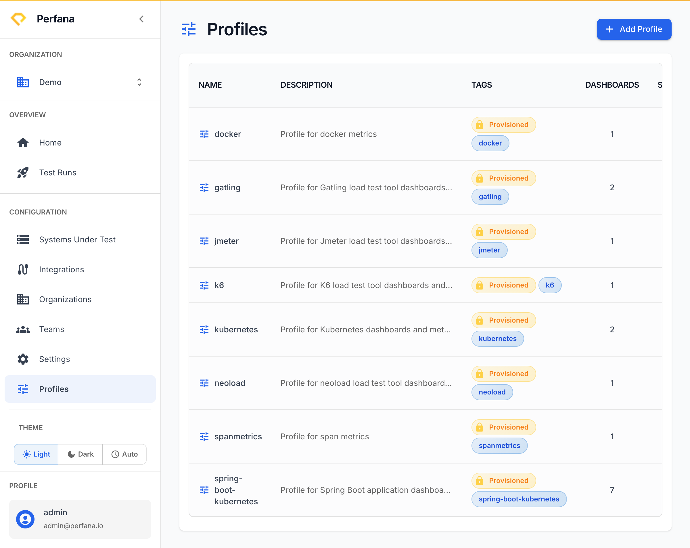
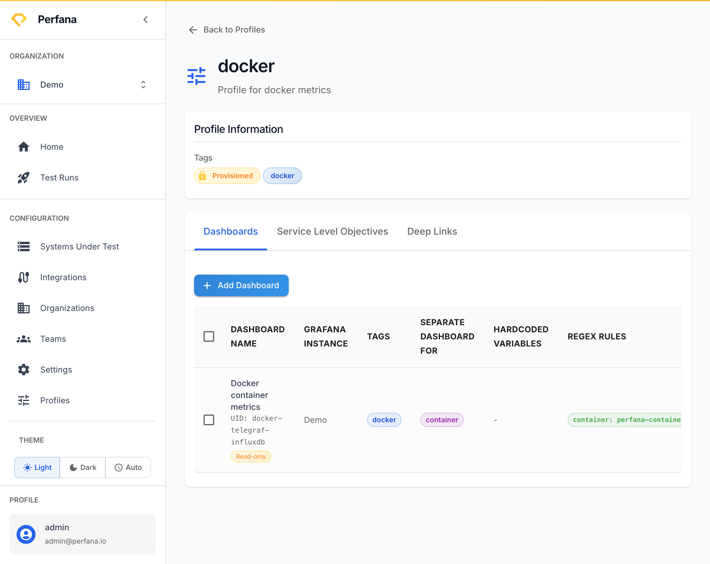

# Create a profile

A profile is a reusable bundle of dashboards and SLOs. Create one so new test runs inherit a standard set of dashboards and checks automatically, instead of you configuring each system from scratch.

**Before you start**
- Select your active organization in the sidebar.
- Know which dashboards and SLOs you want every run to inherit.

**Steps**
1. Go to **Profiles** (`/settings/profiles`).
   You see a table of existing profiles.
   
   *Figure: the Profiles list.*

2. Click **Add Profile**, then enter a **name**, a **description** and any **tags** the profile should match.
   A test run inherits a profile when the two share at least one tag, in the same organization. Tags are matched exactly, so `WERKNL` and `werknl` are two different tags. The field suggests tags your other profiles already use; press Enter to add one.
   The profile appears in the table.

3. Open the new profile to see its detail page (`/settings/profiles/[id]`).
   You see the profile's tabs: **Dashboards**, **Service Level Objectives**, and **Deep Links** (coming soon).
   
   *Figure: a profile's detail tabs.*

4. On the **Dashboards** tab, click **Add Dashboard** and add each dashboard you want runs to inherit.
   The dashboards appear in the list.

5. On the **Service Level Objectives** tab, click **Add Service Level Objective** and add each check.
   The checks appear in the list. For how thresholds and Apdex work, see [Define SLOs](define-slos.md).
   To apply one check to every performance-test scenario of a system (for example, `Transaction Error Rate` below 2% on each JMeter or Gatling scenario), pick **Performance test metrics — every scenario** as the dashboard. The check is added to each scenario dashboard, including scenarios that first appear in a later run; the run-wide *all aggregated* roll-up is left out.

**Result**
The profile holds your standard dashboards and SLOs. New test runs that use this profile inherit them automatically, so you avoid repeating the same setup on every system.

**Edit a profile**
The pencil in the **Actions** column of the Profiles list opens the same dialog on an existing profile, so you can change its **description** and **tags** without deleting it and starting again. A provisioned profile has no pencil and says so on hover. If a save fails, the dialog stays open holding your edit and shows the reason.

The **name** is read-only when editing. A profile's dashboards and deep links reference it by name, with nothing in the database linking them, so renaming it would leave both behind with no error. Three tags — `perfana`, `perfana-template` and `no-anomaly-detection` — are hidden from the field and put back when you save, so an edit cannot drop a tag you were never shown.

**Tip**
Profiles can also be provisioned from CI, so your standard set of dashboards and checks can be created as code.

**Related**
- [Define SLOs](define-slos.md)
- [Concepts](../concepts.md)
