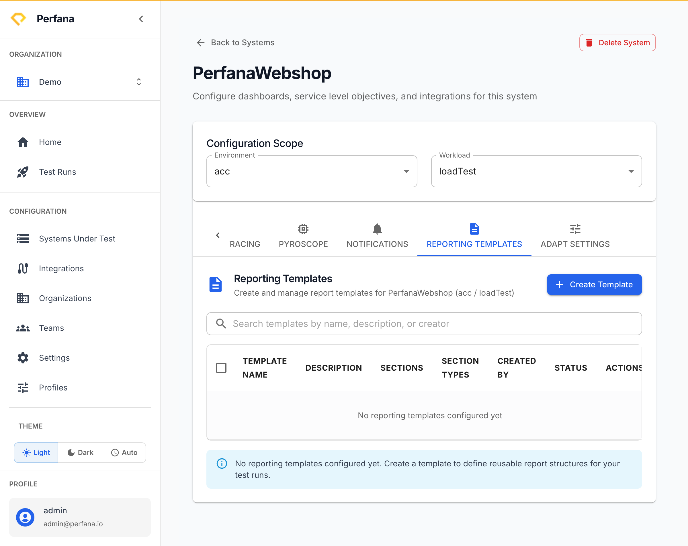

# Manage reporting templates

A reporting template defines what a generated report contains and how it is laid out. Manage templates per system so your reports follow a consistent structure every time.

**Before you start**
- You have a [system under test](create-system-under-test.md).
- The Reporting integration is connected (the **Reporting Templates** tab appears only when it is).

**Steps**
1. Open the system from **Systems Under Test** (`/systems`) using its **Edit Config** button.
   You see the system's configuration page.

2. Open the **Reporting Templates** tab.
   You see the templates already defined for this system.
   
   *Figure: the Reporting Templates tab.*

3. Create a template and configure how it shapes the report.
   The template appears in the list and can be used when generating reports.

4. To remove a template, delete it and confirm in the dialog.
   The template is removed from the list once you confirm.

**Result**
The system has one or more reporting templates. When you generate a report for a run, you can apply a template so the output follows the structure you defined — see [Generate a report](../test-runs/generate-report.md).

## The Comments section

Add a **Comments** section to a template to put the team's [discussion of a run](../test-runs/comments.md) in its report.

- **Which comments**: by default the section lists the comments on every card. To narrow it, pick one or more cards in the section's settings; only threads on those cards are included.
- **How they are laid out**: threads are grouped by card. Each thread shows its first comment and its replies in the order they were written, each with the author and the time in UTC, and **(edited)** where a comment was changed. A thread's [tag](../test-runs/comments.md#tag-a-thread), such as **Root cause**, is printed before its first comment.
- **Graph markers**: a thread started with a [marker](../test-runs/comments.md#pin-a-marker-on-a-graphs-chart) on the Graphs card is headed by the chart it was placed on, drawn from the series and time range recorded with it, with the marker's number called out at its moment. Series that no longer have data are left out of that chart and counted in a note under it.
- **Configuration items**: a thread on a [configuration item](../test-runs/comments.md#comment-on-a-row) prints the comparison it was written against under its first comment, for example *Compared with run Shop-acc-load-00041: 4 → 8 (changed)*, so it stays readable after the card compares with another run.
- **Diff tabs**: a thread written on the Distributed tracing **Traces Diff** tab or the Pyroscope **Diff** view prints the baseline run, or the two time ranges of the run, it was compared with, and for tracing the **Compare Traces** result, under its first comment.
- **Deleted comments** appear as **Comment deleted** where a thread still has replies, so the replies keep their context. A deleted marker gets no chart.
- **Text stays text**: comment text is shown exactly as written. Formatting characters and HTML in a comment are not interpreted.

A report is a snapshot: comments added after you generate it appear only in a report generated again.

### Investigations in a report

Set the section's **Layout** to **Investigations** to print the run's published [investigations](../test-runs/comments.md#walk-through-an-investigation) instead of its threads. A section with no title of its own is headed **Investigations**. Every published investigation of the run is included, oldest publication first, with its title, author and conclusion, and then each step in order: its number, tag, card and row, the comment, and the author's note for that step. A step on a Graphs marker is headed by the marker's chart, and a step on a Configuration row shows the comparison it was written against, as in the **By card** layout. A step whose comment was deleted prints **Comment deleted** with its tag and note. An AI agent's investigation names the person who published it and marks the agent, for example *Anna published · proposed by Claude analysis agent* followed by an **AI** chip, and a step written by an agent carries the **AI** chip next to its author. Drafts are never printed, comments that are in no investigation are left out, and the **Cards** filter does not apply. A run with no published investigation shows "No published investigations for this run." To have both the threads and the investigations in one report, add two Comments sections. Sections saved before this option existed keep the **By card** layout.

**Related**
- [Comment on a test run](../test-runs/comments.md)
- [Generate a report](../test-runs/generate-report.md)
- [Create a system under test](create-system-under-test.md)
