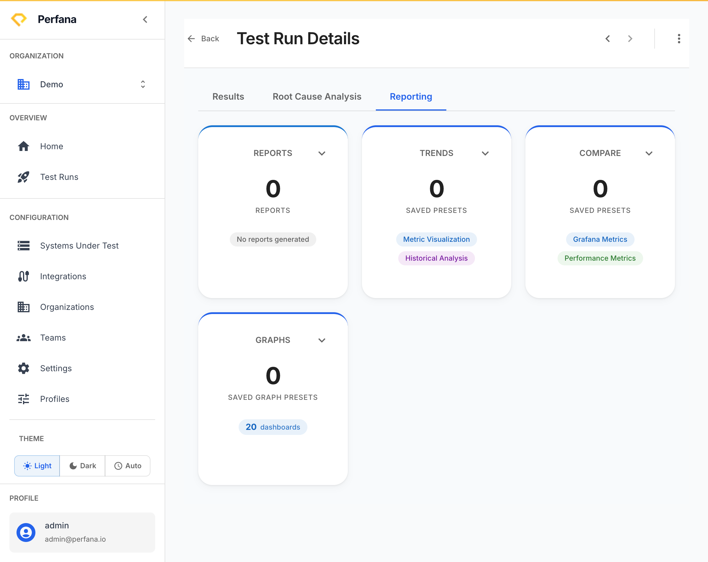

# Compare test runs

This lets you see how one run stacks up against another, and how a metric moves across many runs over time. Use it to confirm a change improved (or hurt) performance, or to spot a slow drift before it becomes a regression.

**Before you start**
- At least two test runs that share the same **system**, **environment**, and **workload**. Runs are only comparable when these three coordinates match — see [Key concepts](../concepts.md).
- Open the run you want to start from at `/test-runs/[id]` and go to the **Reporting** tab.

## Compare two runs

1. On the **Reporting** tab, find the **Compare** card.
   The card shows the comparison entry point for the current run.
   
   *Figure: the Reporting tab - use the Compare card for two runs, Trends across many.*

2. **Pick the run to compare against.**
   Perfana lines up the two runs side by side, showing the metric differences between them.

3. Read the differences to see what changed between the two runs.
   You can tell whether response times, throughput, or errors moved, and in which direction.

### Compare against the control group instead

The first option in the run picker, when it is there, is **Control group**. It compares the current run against the earlier runs anomaly detection judges it against, using their pooled figures. Those are the same "control" values the Anomaly Detection card shows, and they move less than any single run does.

- Once you choose it, the caption under the picker names the runs in the group.
- Opening a metric's graph shows the group's average as a flat dashed line, because a pooled group has no timeline of its own.
- URL panels, and the "All aggregated" entry on a scenario's panels, have no control-group figures, so they show the current value only.
- The first runs of a workload, and a run whose analysis has not finished, have no control group yet, so the option is not offered.

## See a metric trend across many runs

1. On the **Reporting** tab, find the **Trends** card.
   The card shows how a metric has changed across a series of runs.

2. **Choose the metric** you want to follow.
   The trend line plots that metric run over run, so a gradual climb or drop stands out.

**Result**
You can compare two specific runs in detail, and watch a single metric trend across the whole history of comparable runs.

**Troubleshooting**
- *No runs available to compare* — the other run uses a different system, environment, or workload. Only runs sharing all three are comparable. See [Key concepts](../concepts.md).

**Related**
- [Investigate root cause](root-cause-analysis.md)
- [Generate and share a report](generate-report.md)
- [Key concepts](../concepts.md)
