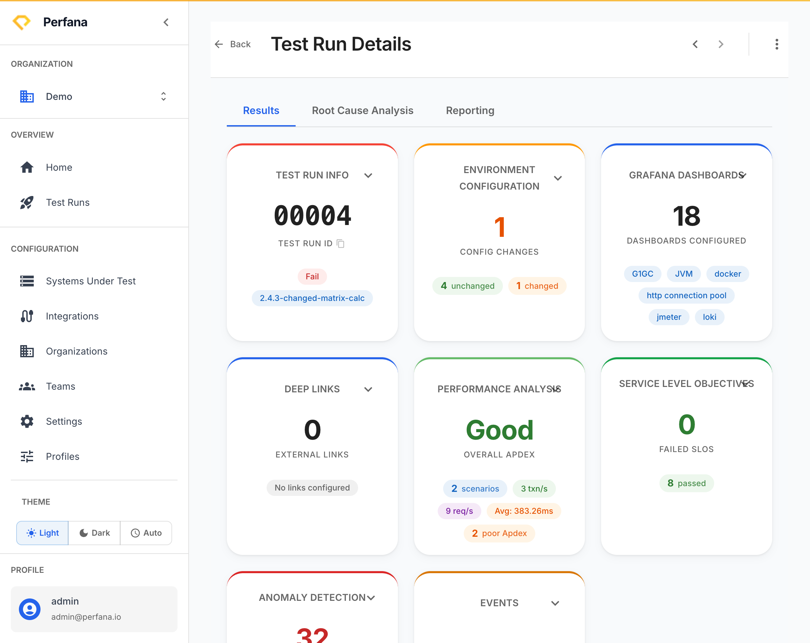
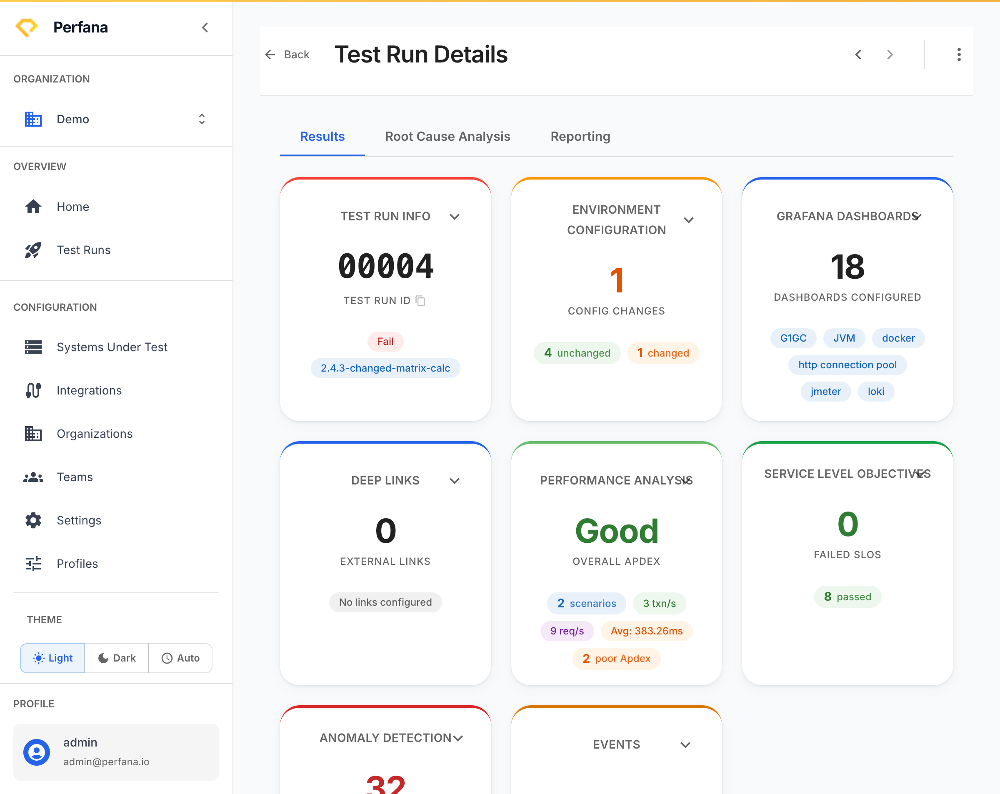
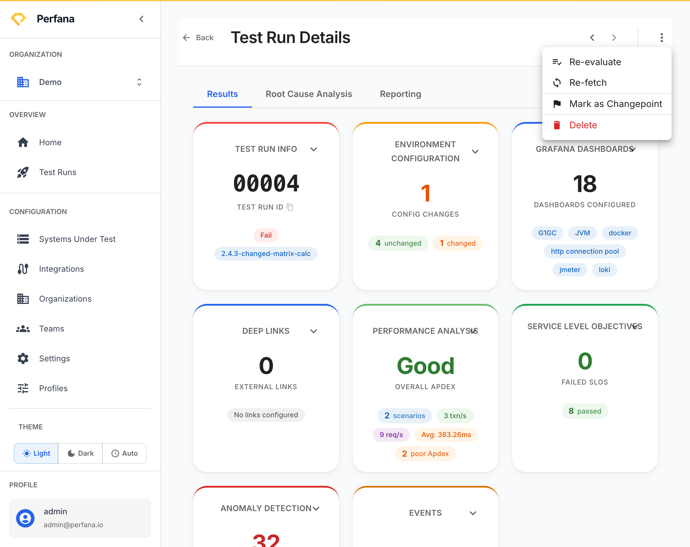

# Read a test run

Open a single test run and find your way around its tabs to understand how the test performed.

**Before you start**
- You need at least one test run in the list. See [Find and filter test runs](find-and-filter-runs.md).

**Steps**
1. From the **Test Runs** list, click the run you want to open.
   You see the test run detail page with a details card and three tabs.
   
   *Figure: the test run detail page and its three tabs.*
2. Read the **details card** for the run's metadata (system, environment, workload, timing). Use it to edit the run's **tags** and **annotations**.
   Your tags and notes are saved to the run for later reference.
3. Open the **Results** tab to review what happened. It groups several sections:
   - **Configuration comparison** — what changed versus a previous run.
   - **Dashboards** — the Grafana dashboards captured for the run.
   - **Deep Links** — shortcuts out to related external tools.
   - **Performance Analysis** — per-transaction statistics, including Apdex; drill into tracing or Dynatrace from here.
   - **Service Level Objectives** — the pass/fail checks and metric series.
   - **Anomaly Detection** — the ADAPT regression verdicts.
   - **Events** — notable events during the run.
   
   *Figure: the Results tab - overview cards for the run.*
4. Open the **Root Cause Analysis** tab when you need to dig into why something happened. It has Dynatrace, Distributed Tracing, Pyroscope, and AWR Report cards.
   You can investigate the underlying system behaviour for the run.
5. Open the **Reporting** tab to produce and compare outputs. It offers **Generate Report**, Trends, Compare, and Graphs.
   You can create a shareable report or compare this run against others.
6. To act on the whole run, open the per-run actions menu. It offers **Re-evaluate**, **Re-fetch**, **Mark as / Remove Changepoint**, **Disable Baseline Mode**, and **Delete**.
   
   *Figure: the run actions menu.*

**Result**
You can read a run's metadata, move between the Results, Root Cause Analysis, and Reporting tabs, and edit its tags and annotations.

**While the test is still running**
Expand **Performance Analysis** to see its live controls, in a row under the card title with the **LIVE** badge:
- **Time window** — show the whole test so far, or only the last 1, 5, 15 or 30 minutes.
- **Refresh** — how often the figures update: **Off**, **10s**, **30s** (the default), **1m** or **5m**. A rate you pick is remembered in this browser for later runs; **Off** applies only until you leave the page.
- **Updated** — the time the figures were last fetched, so you can see a refresh happened even when the numbers did not change.
- With **Off**, nothing updates on its own; use the refresh button that appears to update now.
- If a refresh takes 5 seconds or more, automatic refresh pauses and the caption says **auto-refresh paused**. To resume, pick a rate in **Refresh** (picking the one already shown works too), or press the refresh button: automatic refresh resumes if that refresh finishes in under 5 seconds.

When the test finishes, the card fetches its final figures once and the live controls disappear.

**Related**
- [Check SLO results](slo-check-results.md)
- [Understand ADAPT verdicts](understand-adapt.md)
- [Concepts](../concepts.md)
